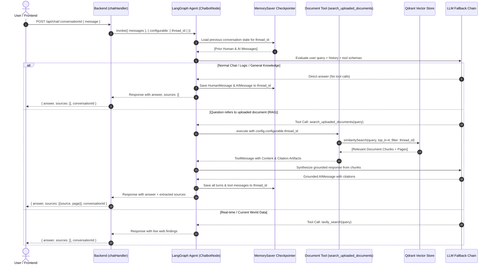

# 🧠 EideticAI — Enterprise Agentic RAG & Knowledge Platform

EideticAI is an enterprise-grade AI knowledge management and search platform. Built with **LangGraph**, **Next.js 16**, **Express**, and **Qdrant Vector DB**, EideticAI combines **Agentic RAG**, persistent multi-turn session memory via **LangGraph MemorySaver**, and an automated **multi-provider LLM fallback chain** (Groq → Google Gemini → OpenRouter).

---

## 🏗️ System Architecture

```mermaid
flowchart TB
    subgraph Client["Frontend Client (Next.js 16)"]
        UI["Modern Ambient UI / Canvas"]
        SearchInput["Search Bar / Chip Prompts"]
        PDFUpload["PDF Drag & Drop Uploader"]
        SessionGen["UUID Conversation Generator"]
    end

    subgraph Proxy["Next.js Rewrite Proxy"]
        Rewrite["/api/:path* ──> process.env.BACKEND_URL"]
    end

    subgraph Backend["Express 5 Backend (:5000)"]
        Router["Express Router (/api/chat, /api/health)"]
        AuthConv["extractConversationId() Helper"]
        Ingest["PDF Parsing & Chunking Engine\n(pdf-parse + RecursiveCharacterTextSplitter)"]
    end

    subgraph AgenticGraph["LangGraph Workflow (StateGraph)"]
        AgentNode["Chatbot Agent Node (LLM Router)"]
        Decision{"routeAgentDecision\nTool Calls Requested?"}
        DocTool["search_uploaded_documents\n(Qdrant RAG Tool)"]
        WebTool["tavily_search\n(Live Web Tool)"]
        Checkpointer[("MemorySaver Checkpointer\nthread_id = conversationId")]
    end

    subgraph External["External Services & Datastores"]
        Qdrant[("Qdrant Cloud Vector DB\n(rag_documents)")]
        LLMFallback["LLM Fallback Chain:\n1. Groq (openai/gpt-oss-120b)\n2. Gemini (gemini-2.5-flash)\n3. OpenRouter (nvidia/nemotron)"]
        Redis[("Redis / BullMQ\nBackground Tasks")]
        Tavily["Tavily Search API"]
    end

    UI --> Rewrite
    SearchInput --> Rewrite
    PDFUpload --> Rewrite
    SessionGen -.->|Passes conversationId| SearchInput

    Rewrite --> Router
    Router --> AuthConv
    AuthConv --> Ingest
    AuthConv --> AgentNode

    Ingest -->|Embeddings + metadata.conversationId| Qdrant

    AgentNode <--> Checkpointer
    AgentNode --> Decision
    Decision -->|search_uploaded_documents| DocTool
    Decision -->|tavily_search| WebTool
    Decision -->|No tools needed (Chat / Memory)| EndNode["Return Response"]

    DocTool -->|Filtered by thread_id| Qdrant
    WebTool --> Tavily
    AgentNode <--> LLMFallback
```

---

## 🔄 Agentic RAG Decision Workflow (Method 3)

Instead of running an expensive vector search on every question, EideticAI uses **Agentic RAG**. The LLM autonomously inspects user intent and decides whether to query documents, search the web, or answer directly from memory.



---

## 🧠 Session Memory (`MemorySaver`) Flow

Conversations maintain seamless context across turns using **LangGraph MemorySaver**:

1. **Frontend Generates Random UUID:** A `crypto.randomUUID()` is generated on the client and associated with the chat session.
2. **Passed to Backend:** Passed via URL parameter (`/api/chat/:conversationId`), JSON body (`conversationId`), or HTTP header (`x-conversation-id`).
3. **Thread ID Isolation:** LangGraph checkpointer stores the message history strictly partitioned by `thread_id`:
   ```javascript
   await chatbotApp.invoke(
     { messages: [new HumanMessage(question)] },
     { configurable: { thread_id: conversationId } }
   );
   ```
4. **Follow-Up Inferences:** Subsequent questions (e.g., *"What was the second point in that summary?"*) retrieve the checkpointed state without re-uploading documents or re-prompting context.
5. **Thread Reset:** Call `DELETE /api/chat/:conversationId` to purge the thread checkpoint from memory.

---

## 📡 API Routes Reference

Base URL (Local): `http://localhost:5000` (or `/api/*` via Next.js proxy)

| Method | Endpoint | Description | Key Parameters |
| :--- | :--- | :--- | :--- |
| `GET` | `/` | Service root status | None |
| `GET` | `/api/health` | Healthcheck & system uptime | None |
| `POST` | `/api/chat/:conversationId` | Send user message to a conversation thread | URL: `conversationId`<br>Body: `{ message: string }` |
| `POST` | `/api/chat` | Fallback chat endpoint (accepts ID in body) | Body: `{ message: string, conversationId?: string }` |
| `GET` | `/api/chat/:conversationId/history` | Retrieve full message history from MemorySaver | URL: `conversationId` |
| `DELETE`| `/api/chat/:conversationId` | Clear session checkpoint from MemorySaver | URL: `conversationId` |
| `POST` | `/api/chat/:conversationId/upload` | Upload & chunk PDF into Qdrant for this thread | Form-data: `pdf` file |
| `POST` | `/api/upload-pdf` | Backwards-compatibility upload fallback | Form-data: `pdf` file |

### Route Details & Payload Examples

#### 1. Post Chat Message
```http
POST /api/chat/550e8400-e29b-41d4-a716-446655440000
Content-Type: application/json

{
  "message": "What is the liability limitation in section 4 of the contract?"
}
```
**Response (200 OK):**
```json
{
  "answer": "According to Section 4 of the uploaded contract, liability is capped at $500,000...",
  "sources": [
    {
      "source": "master_agreement.pdf",
      "page": 4
    }
  ],
  "conversationId": "550e8400-e29b-41d4-a716-446655440000",
  "chatId": "550e8400-e29b-41d4-a716-446655440000",
  "threadId": "550e8400-e29b-41d4-a716-446655440000"
}
```

#### 2. Get Thread History
```http
GET /api/chat/550e8400-e29b-41d4-a716-446655440000/history
```
**Response (200 OK):**
```json
{
  "conversationId": "550e8400-e29b-41d4-a716-446655440000",
  "messages": [
    { "role": "human", "content": "Hello!" },
    { "role": "ai", "content": "Hello! I am EideticAI, how can I assist you today?" }
  ],
  "total": 2
}
```

#### 3. Clear Conversation Thread
```http
DELETE /api/chat/550e8400-e29b-41d4-a716-446655440000
```
**Response (200 OK):**
```json
{
  "message": "Memory checkpoint deleted for conversationId / thread_id \"550e8400-e29b-41d4-a716-446655440000\".",
  "conversationId": "550e8400-e29b-41d4-a716-446655440000"
}
```

#### 4. Upload & Index PDF
```http
POST /api/chat/550e8400-e29b-41d4-a716-446655440000/upload
Content-Type: multipart/form-data; boundary=----WebKitFormBoundary

------WebKitFormBoundary
Content-Disposition: form-data; name="pdf"; filename="contract.pdf"
Content-Type: application/pdf

[BINARY DATA]
------WebKitFormBoundary--
```
**Response (200 OK):**
```json
{
  "message": "Successfully indexed \"contract.pdf\" for conversation!",
  "conversationId": "550e8400-e29b-41d4-a716-446655440000",
  "source": "contract.pdf",
  "pagesCount": 12,
  "chunksCount": 38
}
```

---

## 🛠️ Tech Stack

| Domain | Technology | Purpose |
| :--- | :--- | :--- |
| **Agent & Workflow** | [LangGraph](https://langchain-ai.github.io/langgraphjs/) | StateGraph orchestration, conditional routing, tool execution |
| **Session Memory** | `MemorySaver` | Thread-isolated in-memory checkpointing per conversation |
| **Vector Database** | [Qdrant Cloud](https://qdrant.tech/) | Vector storage, payload filtering on `metadata.conversationId` |
| **Embeddings** | `@langchain/google-genai` | `text-embedding-004` (768 dimensions) |
| **Primary LLM** | `@langchain/groq` | `openai/gpt-oss-120b` (Ultra fast response) |
| **Fallback LLMs** | Google Gemini & OpenRouter | `gemini-2.5-flash` and `nvidia/nemotron-3.5-lightning` |
| **Live Web Search** | `@langchain/tavily` | Tavily Search API for real-time fact retrieval |
| **Backend Server** | Express 5 / Node.js ESM | REST API, Multer upload handling, CORS |
| **Frontend Web** | Next.js 16 (App Router) + React 19 | Responsive UI, dynamic radar animations, modal inspectors |
| **Styling** | Vanilla CSS + Tailwind v4 | Glassmorphism, curated palette, dark mode |

---

## 🚀 Getting Started

### 1. Clone & Install Dependencies

```bash
# Clone the repository
git clone https://github.com/<your-username>/eideticai.git
cd eideticai

# Install backend dependencies
cd backend
npm install

# Install frontend dependencies
cd ../frontend
npm install
```

### 2. Configure Environment Variables

#### Backend (`backend/.env`)
```env
# Primary & Fallback LLM Providers
GROQ_API_KEY=gsk_...
GEMINI_API_KEY=...
OPENROUTER_API_KEY=sk-or-v1-...

# Tavily Web Search
TAVILY_API_KEY=tvly-...

# Qdrant Vector Cloud
QDRANT_URL=https://<your-cluster>.qdrant.io
QDRANT_API_KEY=...
QDRANT_COLLECTION=rag_documents

# Redis (Message Broker)
REDIS_URL=redis://...

# Allowed Frontend Origins (CORS)
FRONTEND_URL=http://localhost:3000,https://eideticai.vercel.app/
PORT=5000
```

#### Frontend (`frontend/.env`)
```env
# Backend API Base URL (Proxied via next.config.mjs rewrites)
BACKEND_URL=http://localhost:5000
NEXT_PUBLIC_BACKEND_URL=http://localhost:5000
```

### 3. Run Development Servers

In terminal 1 (Backend):
```bash
cd backend
npm run dev
```

In terminal 2 (Frontend):
```bash
cd frontend
npm run dev
```

Visit **[http://localhost:3000](http://localhost:3000)** in your browser.

---

## 📄 License

ISC License. Built with ❤️ for enterprise AI knowledge management.
